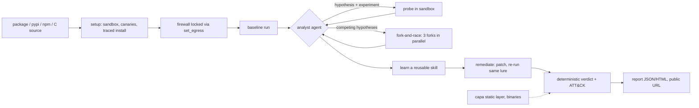

# Sandtrap

**An AI security analyst that lures evasive code into revealing itself inside CreateOS sandboxes, proves what it steals, and patches it.**

Built for the *CreateOS x Stripe Projects* hackathon ("Build agents that run code"). Every probe, compile and patch the agent runs
executes inside a [CreateOS Sandbox](https://createos.sh/docs/Sandbox); the stack (sandbox account, Postgres, agent inbox) was provisioned
with [Stripe Projects](https://docs.stripe.com/projects).

---

## Why this exists

Every `pip install`, `npm install` and `curl | sh` runs a stranger's code on your machine or in your CI. The attacks are not hypothetical:
credential-stealing worms have spread through npm and PyPI by hijacking maintainer tokens, and the payloads usually run at install time,
before any scanner you own has a chance to object.

The tools we have fall short in a specific way:

* **Static scanners** read the code. Obfuscation, staged downloads and encoded strings defeat them.
* **Plain sandboxes** run the code once and report what happened. But modern malware checks its surroundings first: does its command
  server resolve? is a `CI` variable set? has the date passed? are there credentials to steal? In a bare sandbox the answer is no, so it
  stays silent, and "nothing happened" gets reported as *clean*. That is exactly the conclusion the malware wants you to reach.

And the problem is getting more urgent: **AI coding agents now install dependencies on their own**, unattended, on their owners' machines.

## Who it is for

| User | What they do with Sandtrap |
| --- | --- |
| **Developers and open-source maintainers** | Check an unfamiliar dependency before installing it (`scan pypi:<name>`), or email its name to the agent's inbox. |
| **Security and platform teams** | Triage suspicious packages, scripts and binaries with evidence they can act on: ATT&CK techniques, a baseline-versus-lure diff, a verified patch. |
| **AI coding agents** | Call Sandtrap as an MCP tool before running `pip install` / `npm install`. |
| **CI pipelines** | Gate dependency updates on a verdict through the HTTP API. |

## What Sandtrap does

Sandtrap does what a human malware analyst does when a sample plays dead: it **changes the environment until the sample shows itself**.

1. **Install under `strace`** with the sandbox firewall allowing only the package registries, then tighten the firewall live so nothing real
   is reachable.
2. **Baseline run.** Record file reads, process spawns, DNS lookups and connection attempts. A plain sandbox stops here.
3. **The agent investigates.** It reads the baseline and the code, forms a hypothesis about what gates the behaviour, and writes the next
   experiment: a driver script, environment variables, a **fake internet on loopback** (DNS answers, an HTTP/TLS sink, an `iptables`
   catch-all for raw IPs), an advanced system clock, a sink reply. When the gate is unknown it **forks the sandbox** and races up to three
   hypotheses in parallel.
4. **Proof by canary.** Fake credentials carrying a unique per-scan token are planted in `~/.ssh`, `~/.aws`, `~/.npmrc` and `.env`. If the
   sample sends them, the sink captures the token: exfiltration is *proven*, not inferred.
5. **A deterministic verdict.** Verdict, score and MITRE ATT&CK mapping are computed by plain code from observed events. The model never
   decides it, so text printed by a sample cannot talk its way to "clean" (a prompt-injection fixture is part of the test set).
6. **Remediation with proof.** The agent writes a patch, the lab re-runs the *exact* lure that caught the sample, and checks that nothing
   leaks and a smoke test still passes.
7. **Report.** JSON plus a self-contained HTML report (verdict, baseline-versus-lure diff, egress firewall timeline, ATT&CK table, patch),
   optionally hosted at a public URL by another CreateOS sandbox.



## Why CreateOS Sandbox is the right substrate

Analysing hostile code needs a real isolation boundary, a controllable network and cheap, fast, disposable machines. CreateOS Sandbox gives
each scan a microVM with its own kernel (so `strace`, `iptables`, the system clock and `gcc` all work as root), a per-sandbox egress
allowlist that can be changed while the sandbox runs, `pause` and `fork` to clone a prepared machine in seconds, and a public URL for hosting
results. Sandtrap uses all of them for a reason, not as a checklist.

## How the sponsor tools are used

| Tool | Used for |
| --- | --- |
| **Stripe Projects** | `stripe projects init`, then `add createos/free`, `createos/project`, `neon/free`, `neon/postgres`, `agentmail/free`, `agentmail/api`. The sandbox account, its credentials, the Postgres database and the agent's inbox come from the CLI and land in `.env`; `.projects/state.json` is committed. `sandtrap doctor` verifies the stack. |
| **CreateOS Sandbox** | create/destroy per scan; command and files APIs; **egress control** (registry-only, then locked, with readback in the report); **pause + fork** (fork-and-race, three parallel clones); **ingress / public URL** (hosted reports); `strace`, `iptables`, `date -s` and `gcc` inside the VM; a 2 GB shape for capa; garbage collection of leftovers. |
| **Neon (via Stripe Projects)** | LangGraph checkpoints of every scan are stored in the provisioned Postgres (in-memory fallback if unreachable). |
| **AgentMail (via Stripe Projects)** | The agent's own inbox: email `pypi:<package>` and the reply carries the verdict, evidence and a public report link. |

Measured on the Free plan during the build: forks work, pause/resume preserves state, a public URL works, `date -s` works, Docker and `iptables`
NAT run inside the sandbox, and the account has a concurrent-sandbox quota of 5 (paused sandboxes count).

## Results

**On 12 fixtures (10 malicious, 2 clean) Sandtrap detected 10/10 malicious samples; the same run scored as a plain sandbox detected 4/10.**
Both clean fixtures and a real PyPI package (`six`) came out clean. On a compiled binary that stays silent unless its C2 host resolves, the
plain sandbox says *clean* while Sandtrap proves the exfiltration. The full table, with each fixture's gate and timings, is in
[docs/BENCHMARK.md](docs/BENCHMARK.md). The fixtures are small samples written for this project, so this shows the mechanism works, not
detection rates on real-world malware.

## Run it

Prerequisites: Python 3.13 with [uv](https://docs.astral.sh/uv/), the Stripe CLI with the Projects plugin, and a `gcloud` login for Gemini
(or `LLM_PROVIDER=k2` with a K2 key).

```bash
stripe plugin install projects
stripe projects init
stripe projects add createos/project          # writes CREATEOS_* to .env
stripe projects add neon/postgres             # optional: checkpoint database
stripe projects add agentmail/api             # optional: email intake
cp .env.example .env                          # then fill the LLM settings
curl -L -o analyzer/bin/capa-linux.zip https://github.com/mandiant/capa/releases/download/v10.0.0/capa-v10.0.0-linux.zip
uv sync --group test

uv run python -m src.cli.sandtrap doctor                                  # verify the stack
uv run python -m src.cli.sandtrap scan fixtures/gated-stealer             # the hero demo
uv run python -m src.cli.sandtrap scan c:fixtures/c/gated_beacon.c        # compiled ELF: capa + lure
uv run python -m src.cli.sandtrap scan npm:fixtures/npm-postinstall-beacon # npm lifecycle scripts under the lure
uv run python -m src.cli.sandtrap scan pypi:six                           # a real PyPI package (comes out clean)
uv run python -m src.cli.sandtrap scan fixtures/gated-stealer --publish   # host the report at a public URL
uv run python scripts/bench.py                                            # plain sandbox vs Sandtrap on every fixture
uv run pytest tests -q
```

Reproduce the Stripe Projects stack in one command: `stripe projects init --from "https://projects.dev/s#v1:createos~project,Neon~postgres"`.

### Interfaces

* **CLI**: `scan`, `doctor`, `gc`, `publish`, `mail` (above).
* **HTTP API** with live Server-Sent Events: `uv run uvicorn src.app.main:app --port 8000`, then `POST /api/v1/sandtrap/scan` with
  `{"target": "pypi:six"}` and `GET /api/v1/sandtrap/scan/{job}/events`. Targets are allow-listed (`pypi:<name>` or `fixture:<name>`).
* **MCP server** for coding agents: `claude mcp add sandtrap -- uv run python -m src.mcp.sandtrap_server` (tools `scan_package`, `get_report`).
* **Email**: `uv run python -m src.cli.sandtrap mail` prints the agent's inbox address and answers requests.

## Architecture

| Path | Role |
| --- | --- |
| `src/app/sandtrap/` | the product: sandbox sessions (`sandbox.py`), the lab (`lab.py`), the analyst agent (`analyst.py`), the LangGraph pipeline (`graph.py`), deterministic scoring and ATT&CK mapping (`score.py`, `attack.py`), remediation (`remediate.py`), fork-and-race (`race.py`), reports (`report.py`), threat memory and skill learning (`memory.py`, `learn.py`), hosting, mail, enrichment, doctor |
| `analyzer/` | runs inside the sandbox: lure server (fake DNS + sniffing TCP sink), strace parser, probe runner, canary planter |
| `src/app/static/` | static layer: capa capability analysis of binaries inside the sandbox, VirusTotal hash lookup |
| `src/app/core/`, `src/app/api/`, `src/app/agents/` | agent infrastructure: middleware, guardrails, tracing (Langfuse), metrics, the API shell, the deep-research agent |
| `src/mcp/`, `src/cli/` | MCP server and CLI |
| `fixtures/` | harmless samples used by the tests and the benchmark |

Models: the analyst runs on Gemini 3.5 Flash through Vertex AI (an httpx transport refreshes the gcloud token and carries Gemini 3's thought
signatures across tool-call turns). K2 and Groq work as drop-in alternatives via `LLM_PROVIDER`.

## Safety model

* Samples are **harmless fixtures written for this project**; no real malware is included or needed.
* The real internet is never reachable from a sample: the firewall is locked before any analysis and the fake network lives on loopback.
* Credentials inside the sandbox are fake canaries. Nothing real ever enters it.
* Everything a sample prints is treated as hostile data: control characters stripped, injection phrases redacted, fenced for the model, and
  irrelevant to the verdict, which is computed from events.
* Sandboxes are always destroyed (`finally`), forks included; `sandtrap gc` removes leftovers.

## Limitations (honest)

* Dynamic analysis is Linux only; HTTPS request bodies are not readable without interception, only the TLS server name is logged.
* Evasion beyond our levers (tracer detection, long monotonic sleeps without a shim, hardware checks) can look quiet; such runs are
  `inconclusive`, or `clean` with **low confidence**, never "safe".
* Canary proof covers the credential types we plant.
* The threat-memory skill library is a working mechanism, not yet a measured speed-up: on our simple fixtures the model reads the code and
  does not need the skills.
* The Free plan page says one sandbox; the platform let us run several (quota 5). Fork-and-race falls back to sequential runs if forks are refused.
* The analyst depends on Gemini through the author's gcloud login; switch with `LLM_PROVIDER=k2` for another provider.

## Roadmap

HTTPS interception for request bodies, Docker-in-sandbox hardened execution per sample (verified possible inside CreateOS sandboxes), a
decompiler for stripped binaries, pgvector similarity over past scans, parallel fan-out of static and dynamic analysis across forks, and a
sender allow-list for the email intake.

## Credits and licence

All Sandtrap functionality (the sandbox layer, analyzer, lure, analyst, scoring, remediation, fork-and-race, reports, API routes, MCP server,
hosting, memory, mail intake, fixtures and benchmark) was built during the hackathon, and the git history shows the order. The project was
built with Claude Code (permitted by the rules). Development log: [docs/DEVLOG.md](docs/DEVLOG.md); decisions and tradeoffs:
[docs/DECISIONS.md](docs/DECISIONS.md).

MIT, see [LICENSE](LICENSE).
